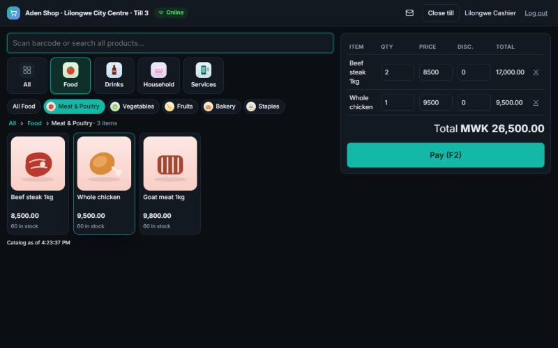
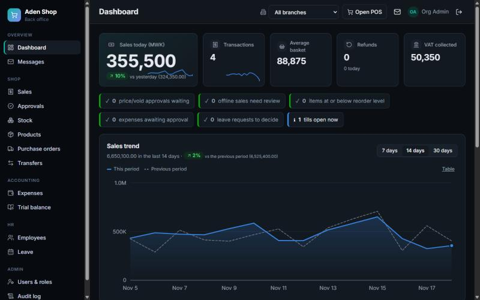
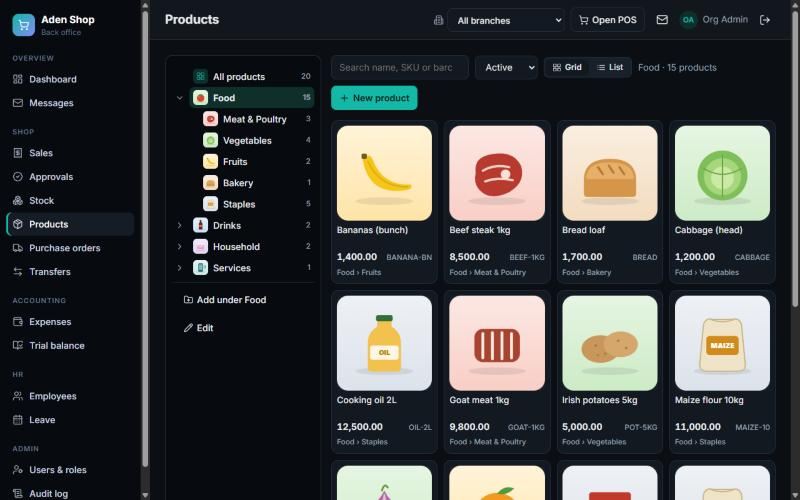
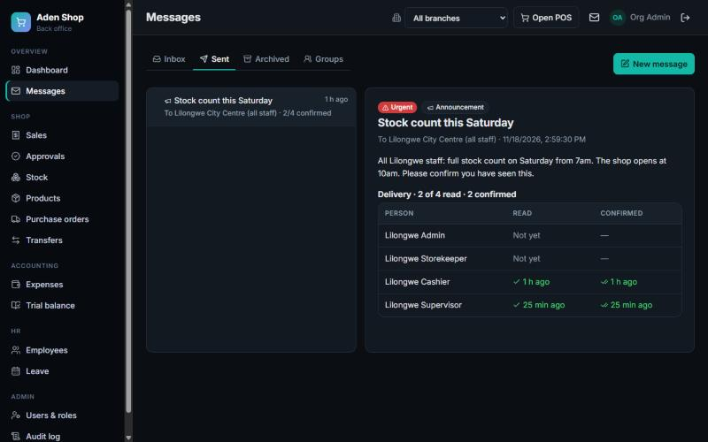

# POS System — multi-branch shop management, inventory & POS

[](https://github.com/obrianmw/pos-system/actions/workflows/tests.yml)


Python/Django backend (REST API + admin back office) and a React/TypeScript point-of-sale that keeps selling offline.
Built for **Aden Shop**: several branches, a till per counter, and a back office for managers, accountants and HR.

## Screenshots

| | |
|---|---|
| **Till:** browse by department and subcategory, picture tiles, basket | **Dashboard:** today's figures, trends against the previous period, alerts |
| [](docs/screenshots/pos.jpg) | [](docs/screenshots/dashboard.jpg) |
| **Products:** category tree with counts, photo grid | **Messages:** announcements with read receipts and confirmations |
| [](docs/screenshots/products.jpg) | [](docs/screenshots/messages.jpg) |

*Screenshots use the demo data from `seed_demo`. The product pictures are built-in illustrations; real shops upload photos.*

| Layer | Choice |
|---|---|
| Backend | Python 3.13, Django 5.2, Django REST Framework, JWT auth |
| Database | PostgreSQL (SQLite automatically for local dev when `DATABASE_URL` is unset) |
| Jobs | Celery + Redis (payment status checks, reports) |
| POS front end | React 18 + TypeScript + Vite, IndexedDB offline queue |
| Back office | React pages at `/#/office` (dashboard, sales, stock, approvals, accounting, HR, users); Django admin for master-data entry |

## Turning it on and off

Double-click **`server.cmd`** for the control window (Start, Stop, Restart, Open POS, Back office, Phones on/off, Change password). It shows a green or red light and uptime for each server.

**Start, Stop, Restart, Change password and closing the window need the server control password.** You choose it the first time (12+ characters with upper- and lower-case letters, a number and a symbol). It is stored only as a hash in `.run\control-password`; five wrong tries lock the controls for 15 minutes; every action goes to `.run\control.log`. **Closing the window stops the servers.** Forgot it? An administrator with access to this computer deletes `.run\control-password` and chooses a new one. This password is separate from the till/back-office logins and from the database credentials.

Or from a terminal:

```bash
server.cmd start
```

```bash
server.cmd stop
```

`restart` and `status` work the same way. One command controls both the API/admin (port 8100) and the POS/back office (port 5180). They listen on this computer only. Logs go to `.run\api.log` and `.run\web.log`. If you close the window while the servers are running, it asks whether to stop them.

### Phones and tablets on the shop network

Phone cameras only work on secure (https) pages, so phones need **Phones on**: the *Phones on/off* button, or `server.cmd phones-on` (password needed; `phones-off` turns it back). The web app then answers on the shop network over https with a certificate made on this computer. `status` and the start message show the phone address (e.g. `https://192.168.1.20:5180/#/count`). Each phone accepts the security warning once. Windows may ask to allow Node.js on private networks.

Only the web app is opened to the network. The API stays on `127.0.0.1` and phones reach it through the web app's `/api` proxy. The database admin site (`/admin/`) isn't proxied, so it still works only from the admin networks.

### Ports
The API and database admin use port **8100** and the POS/back office use **5180**. If another program already uses one of them, **Start** moves to the next free port, remembers it in `.run\ports.json`, and says so. Both servers are told each other's port, and `status` shows the ports in use. `http://localhost:8100/` opens the database admin sign-in.

## Quick start (local)

```bash
cd backend
python -m venv .venv
.venv/Scripts/pip install -r requirements.txt
.venv/Scripts/python manage.py migrate
.venv/Scripts/python manage.py seed_demo
.venv/Scripts/python manage.py runserver 8100
```

```bash
cd frontend
npm install
npm run dev
```

The POS runs at http://localhost:5180, the back office at http://localhost:5180/#/office, and the Django admin at http://localhost:8100/admin/.

For a dashboard with history, also run `.venv/Scripts/python manage.py seed_sales --days 30`. It generates about 650 back-dated demo sales across both branches.

`seed_demo` creates **Aden Shop** with two branches (Lilongwe, Blantyre), 3 tills each, products with stock, payment methods and one user per role:

| User | Role | Scope |
|---|---|---|
| `owner` | Organization Admin (also Django superuser) | all branches |
| `accounts` | Organization Accountant | all branches |
| `hr` | Organization HR | all branches |
| `ll_admin` / `bt_admin` | Branch Admin | own branch |
| `ll_super` / `bt_super` | Supervisor | own branch |
| `ll_cash1` / `bt_cash1` | Cashier | own branch |
| `ll_store` | Storekeeper | Lilongwe |

Password for every demo user is `demo-pass-2026`, and the supervisor PIN is `2468`. These are demo values only: change them before any real use.

Run the tests: `cd backend && .venv/Scripts/python -m pytest`

With Docker (Postgres + Redis + API + worker): copy `.env.example` to `.env` and fill in the two database passwords (see *Security* below), then `docker compose up --build`. To load the demo data, run `docker compose run --rm migrate python manage.py seed_demo` (it needs the owner role).

## How it is organised

```
backend/apps/
  core/        Organization → Branch → Till, audit log, document numbering
  accounts/    User, Role (list of permission codes), Membership (user + role + branch or org-wide)
  catalog/     Products, categories, tax rates (VAT 16.5% inclusive), per-branch prices
  inventory/   Stock ledger, stock levels, suppliers, purchase orders, branch-to-branch transfers
  sales/       Till sessions, checkout, supervisor overrides, void, refund, offline sync
  payments/    Payment methods + provider plug-ins (cash/bank/card, Airtel Money, M-Pesa, MTN MoMo, PayChangu)
  accounting/  Double-entry ledger, auto-postings, expenses, cash movements, trial balance
  hr/          Employees, departments, attendance, leave, shift rota
frontend/src/  POS screen, offline catalog cache + sales queue
```

### Roles and permissions
Permission codes (`pos.sell`, `pos.price_override`, `inventory.adjust`, `accounting.post`, `hr.approve_leave`, …) are listed in `apps/accounts/permissions_catalog.py`. A **Role** is a named list of codes. A **Membership** gives a user a role either at one branch, or at every branch (org-wide roles such as Organization Admin, Accountant or HR). Every API list is filtered to the branches where the user holds the relevant code. Organizations can create their own roles from the admin or the `/api/roles/` endpoint without code changes.

### Supervisor overrides
Price changes, discounts above the branch limit (`Branch.max_cashier_discount_pct`), voids and refunds need a supervisor. A supervisor can approve in two ways:
- **PIN at the till.** The cashier's screen asks for the supervisor's username and PIN, and the server verifies them.
- **Remote approval.** The cashier sends a request (`POST /api/overrides/`), and the supervisor approves it from their own screen (*Approvals*). Each approval can be used only once.

Users can never approve their own requests. `Product.min_price` is a floor price that no override can go below. Every override is stored with who approved it and how, and failed PIN attempts go to the audit log.

### Stock and money
- Stock changes only through `inventory.services.move_stock`, which locks the stock row (so two tills can't sell the last item) and writes an append-only movement.
- Every sale, refund, void, goods receipt, stock adjustment, till variance, expense and cash movement posts a balanced journal entry. Each wallet or payment method can have its own ledger account, so each can be reconciled against its statement.
- **Till sessions:** see *Tills, the vault and cash* below.

### Tills, the vault and cash
- **Tills:** branch admins create them (*Tills* page) and choose who may open each one.
  - A till can be assigned to many people, but only one person can have it open at a time.
  - A person can have only one till open, and a till that's in use shows as *In use by …*.
- **Opening and closing:** tills always open at **0**.
  - The float comes from the vault.
  - At closing, the cashier counts the drawer. Any over/short is posted to account 5200, and all the counted cash is handed to the vault, so the till closes at 0.
- **Vault:** one per branch.
  - An admin hands it to a person for the day, or until a chosen time.
  - While they hold it, that person is the branch's authorizer: they approve price changes, discounts, voids and refunds, and move vault cash. The rights end when the vault is handed on or the time runs out.
- **What the holder can do:** give floats, pick up cash from tills, pay cash to finance, bank deposits and withdrawals (slip number required), and restocking payments (supplier and invoice required).
- **Handovers wait for the holder:** cash a cashier hands over (closing a till, or a *Cash drop* from the till) goes to *Cash in transit* (1004).
  - It **settles in the vault only after the holder counts and confirms it**.
  - A different count needs a note, and the difference is booked to over/short.
  - Nobody can confirm cash they handed over themselves; an org admin can.
- **Ledger:** every movement posts to the ledger (vault 1001, finance 1003, in transit 1004). Balances come from the ledger, and the history has filters by type, status and date.

### Scanning, labels and payment QR
- **Every common scanner works:**
  - USB and Bluetooth scanners in keyboard mode (1D and 2D, ending with Enter, Tab or nothing) work anywhere on the till and back office, not only in the search box.
  - Serial/COM-port scanners connect with the till's *Connect scanner* button (Chrome/Edge).
  - Phone, tablet and webcam cameras use the *Scan* buttons.
- **Code formats:** codes are cleaned the same way on the till and the server.
  - AIM prefixes, GS1 data such as `(01)…(17)…`, and GS1 Digital Link or `?code=` URLs in QR codes are all understood.
  - UPC-A, EAN-13 and GTIN-14 versions of the same number match each other.
- **QR shelf labels:** *Products → QR labels* prints the products listed. Each QR holds the barcode (or the SKU), so every scanner reads it.
- **Pay by QR** on the till shows a QR for a payment method's merchant number or bank account, with the amount and a reference.
  - Set these in the payment method's settings: `qr_merchant`, `qr_bank` / `qr_account` / `qr_account_name`, or a `qr_template` with `{amount}`, `{ref}` and `{merchant}` for a provider's own QR format.
  - Online-gateway checkouts also show their link as a QR.

### Uploading stock from Excel
On *Stock → Upload from Excel*:
1. Download the template (`stock-upload.xlsx`), or use your own sheet. It needs a header row with **SKU** or **Barcode**, and **Quantity**.
   - Optional columns: Name, Category (like `Food/Meat`), Unit, Cost, Price, Reorder level.
   - Common header names are recognised, such as Qty, Item code and Selling price.
2. Choose the branch and what the quantities mean:
   - **Add to stock**: goods in without a purchase order, or opening stock. The value is booked as Dr Inventory / Cr Opening stock.
   - **Stock count (replace)**: the shelf count replaces the system quantity, and the differences go to shrinkage.
3. **Check the file.** Every row is shown with its quantity now, the change and the result, and any problem is explained.
   - Nothing is saved until every row is right; then everything is saved at once.
   - People with catalog rights can create new products from rows that have a Name, Price and SKU. Missing categories are created too.

Barcodes match in any UPC/EAN/GTIN length. Old `.xls` files must be saved as `.xlsx` first. Limits: 5 MB and 5,000 rows per upload. Every upload is in the audit log with its reference (`UPL-…`).

### Stock takes on phones
- **Counting:** open `#/count` on a phone (the back office shows a QR to it) and sign in.
  - Counters start or join a stock take and scan items. Each scan adds one, or they can type the shelf total.
  - Counts are blind by default: counters don't see the system quantity.
- **Verifying:** a verifier who didn't count the sheet sees the differences, can recount lines, then approves.
  - Approval posts the differences as adjustments, valued to shrinkage.
  - Differences are worked out against the quantity when each item was counted, so sales made during the count stay correct.
- **Look up:** the same screen scans an item to show its stock and price at every branch you work at.
- **Roles:** new *Stock Taker* and *Stock Verifier* roles. Supervisors and branch admins can count and verify; storekeepers can count.

### Offline POS
The till caches the branch catalog, prices, stock and payment methods in IndexedDB. If the server can't be reached, cash and own-terminal card sales are queued locally with a till-generated receipt number and a `client_uuid`. They sync to `/api/sales/sync/` on reconnect and every 30 seconds, and resending is harmless. A sale made offline is always accepted, because it has already happened at the counter. If it broke a rule (an unverifiable PIN, stock going negative, a reused receipt number), it is flagged `needs_review` instead of being rejected.

### Payments
`apps/payments/providers/` contains one class per provider, all with the same `initiate / check_status / reference_from_callback` interface. Wallet callbacks arrive at `/api/payments/callback/<provider>/`. **The callback body is never trusted**: the server always asks the provider for the real status before marking a sale as paid. Credentials go in environment variables (see `backend/.env.example`), never in the database.

| Provider | Status |
|---|---|
| Cash, bank transfer, own card terminal, store credit | Working |
| Airtel Money (Africa API), M-Pesa (Daraja STK push), MTN MoMo (Collections), PayChangu (cards + Airtel/TNM in Malawi) | Written against each provider's published API, tested here with mocks only. **Test each against its sandbox before going live.** |
| TNM Mpamba direct | Placeholder: TNM supplies API docs to merchants on application. Use PayChangu for Mpamba until then. |

## Main API endpoints
`/api/auth/token/` · `/api/me/` (+ `preferences`) · `/api/tills/` · `/api/cash/vaults/` (+ `assign`, `release`, `move`, `confirm`, `candidates`) · `/api/cash/transfers/` · `/api/stock-counts/` (+ `scan`, `submit`, `recount`, `approve`, `reopen`, `cancel`) · `/api/stock/lookup/?code=` · `/api/stock/import/` (+ `template/`) · `/api/admin-handoff/` · `/api/system/overview/` · `/api/branding/` (+ `settings`) · `/api/proformas/` · `/api/pos/catalog/` · `/api/till-sessions/` (+ `close`, `drop`, `summary`, `current`) · `/api/sales/` (checkout, + `sync`, `void`, `refund`, `cancel`, `add_payment`) · `/api/overrides/` (+ `approve`, `reject`) · `/api/products/` · `/api/stock-levels/` (+ `low`) · `/api/inventory/adjust/` · `/api/purchase-orders/` (+ `receive`) · `/api/transfers/` (+ `send`, `receive`) · `/api/accounting/*` · `/api/reports/trial-balance/` · `/api/reports/sales-summary/` · `/api/hr/*` · `/api/users/` (+ `assign_role`, `revoke_role`) · `/api/audit-logs/`

Send `X-Branch-ID: <id>` to choose the branch you are working in. Every list takes `?search=`, `?ordering=<field>` (or `-<field>`), its own filters and `?from=YYYY-MM-DD&to=YYYY-MM-DD`.

## Back office
`#/office` in the same web app. Each person sees only the pages their role covers, for the branches they belong to. Org-level roles get an *All branches* picker.

| Page | Who sees it | What it does |
|---|---|---|
| Dashboard | everyone with a back-office role | Today's sales (with % change vs yesterday and a 14-day sparkline), transactions, average basket, refunds, VAT; a sales-trend chart comparing this period with the previous one (hover or arrow keys for each day); a busiest-times heatmap by weekday and hour; payment mix; sales by branch; top products; counts of things waiting, each linking to its page. Every chart has a Table view |
| Messages | everyone | Inbox, Sent (who has read / confirmed), Archived, Groups. See *Messages & announcements* below |
| Sales | supervisors, branch admins, accountants | Search receipts, open line/payment detail, mark offline sales as reviewed |
| Approvals | supervisors | Approve/reject remote price, discount, void and refund requests (refreshes every 5 s) |
| Stock | storekeepers, branch admins | Stock on hand, reorder alerts, stock value, count adjustments |
| Products | catalog managers | Head office creates/edits products (SKU and barcode uniqueness, floor price, margin shown); branch admins see them read-only and set their own branch price |
| Purchase orders | buyers, storekeepers | Create orders (add suppliers inline, scan or search items), receive full or partial deliveries into stock, cancel before anything arrives |
| Transfers | storekeepers, branch admins | Move stock between branches: pick any branch as destination, see what is in stock before sending, send now or save a draft; the receiving branch confirms arrival. Drafts can be cancelled; goods in transit must be received |
| Expenses, Trial balance | accountants | Record expenses (approved by a second person), check that the books balance |
| Employees, Leave | HR | Add and edit staff (numbered automatically), departments, linked system login; terminating someone also disables their login at once. Salary, bank and ID details are shown only to HR who manage that person. Approve/reject leave |
| Vault & cash | branch admins, the vault holder, accountants | Vault balance and holder, handovers waiting for confirmation, open tills with float/pickup, bank/finance/restocking movements, filtered history |
| Tills | branch admins | Create tills, choose who may open each one, switch tills off |
| Stock takes | counters, verifiers, branch admins | Start, follow, verify and post stock takes; phone link |
| System | org admins (everything), branch admins (their branches) | Needs-attention list; today's operations; database, background jobs, disk, server and security health; 14-day activity by type; notable events (failed sign-ins and PINs, server errors, voids, user and vault changes); branch and organization settings. Whole organization or the branch picked at the top. Refreshes every minute |
| Users & roles, Audit log | branch/org admins | Grant and remove roles per branch, review sensitive actions |
| Branding | organization admins | Shop name, tagline, logo and brand colours (with light/dark previews and a contrast check); receipt, invoice and proforma layout with live previews |

Everyone uses the same sign-in screen and goes straight to their place:
- Organization Admin, Accountant, HR and branch admins go to the back office.
- Anyone who can sell goes to their branch's till: the branch they last used on that device, else their first selling branch. People who sell at several branches can switch branch on the *Open till* screen.
- Everyone who can use more than one part of the system gets tabs in every header: **Till · Back office · Stock · Database admin**. Database admin is shown only to organization admins; it opens the admin site on the API port in a new tab, and still works only from the admin networks.
- The database admin site looks and behaves like the POS: the same sign-in card, the shop's name, logo and brand colours (kept readable in light and dark), the person's own light/dark choice, and the same tabs back to the till, back office and stock. Error pages use the brand colours too.
- Opening **Database admin** from the POS signs you straight in through a one-time link (valid for one minute). The admin-network rule still applies.
- Giving someone the Organization Admin role lets them sign in to the database admin site, and removing the role takes that away. Branch admins and other staff are told plainly that it's for organization admins.

Every list has search, filters (status, type, dates and others) and sortable column headers.

## Themes, branding and documents

**Light, dark or system.** Everyone has a three-way switch (sun / monitor / moon) on the sign-in card, the till header and the
back-office header. *System* follows the device. The choice is saved on the person's account (`/api/me/preferences/`), so it
follows them to any till or PC; if an account has never chosen, the choice made on that device is kept and saved.

**Branding** (Admin → Branding, organization admins only):
- Shop name, tagline and logo (PNG/JPEG/WebP up to 3 MB; checked server-side, kept transparent, shrunk to 512 px).
- Main and accent colour (pickers, hex codes, presets). The app derives readable colours for each theme automatically:
  *buttons* keep the exact brand colour whenever white or near-black text reads on it (4.5:1 or better), otherwise the shade is
  nudged; *links, borders and highlights* are darkened (light mode) or lightened (dark mode) until they reach 4.5:1 against the
  page. The hue never changes. A contrast table shows every pair and its ratio. Chart colours are never re-coloured, so a
  colour always means the same thing.
- The login page shows the shop's name, tagline and logo (`GET /api/branding/`, public). Everything is cached so tills keep
  their look offline.

**Documents** (Branding → Receipts & documents), each with a live preview:
- *All documents:* business name, address, phone, email, TPIN/VAT number, print the logo or not.
- *Receipt* (till printer): 80 mm or 58 mm paper, header, footer, show VAT / cashier / product codes.
- *Invoice* (A4, from any completed sale: back office → Sales → open a sale → Invoice): title, number prefix
  (invoice number = prefix + receipt number), terms, how to pay (bank / mobile money), footer.
- *Proforma* (A4 quotation, from the till's **Proforma** button): title, number prefix, validity in days, terms, footer.
  Proformas are priced by the server at the branch's prices (changing a price needs a supervisor, never below the floor
  price), numbered (`PF-000001`...), saved for reprinting (`/api/proformas/`), and do not touch stock or the books.

Printed documents always use paper colours (white background, the light-mode brand shade), whatever theme the screen is in.

## Messages & announcements
Anyone with **comms.send** (supervisors, branch admins, accountants, HR by default) can send a message or an announcement to any mix of:
individual people, departments, staff groups (saved lists such as "Weekend shift"), whole branches, or roles. **comms.broadcast**
(Organization HR and Admin by default) adds *Everyone - all staff*. Branch-level senders can only reach people in their own branches:
naming someone outside is refused, and a department or role that spans branches is trimmed to theirs (the sender is told how many were left out).

- Priority Normal / Important / Urgent. Urgent messages, and anything that asks to be confirmed, show as a banner on every screen,
  including the tills, until read or confirmed.
- "Ask people to confirm" adds a *Got it* button; the sender sees, per person, who has read and who has confirmed.
- Everyone has an inbox (back office, or the envelope icon on the till) and can reply to the sender of anything they received.
- Who received a message is fixed when it is sent; later staff changes do not alter it. Every send is in the audit log.
- Delivery is in-app only for now (no SMS or e-mail).

## Security

**Three separate sets of credentials**

| What | Who has it | Used for |
|---|---|---|
| Server control password | whoever runs the server PC | Start/Stop/Restart/close in `server.cmd` |
| Till / back-office logins | every staff member | the POS and back office, limited by role and branch |
| Database credentials (`.env`) | database administrators only | the database itself, never typed into the app |

**Database (PostgreSQL via `docker-compose.yml`)**
- Two database roles, neither of them an app login: `DB_OWNER_*` creates the tables (the one-off `migrate` service) and is for
  database administrators; `DB_APP_*` is what the running app uses and can only read and change rows. It cannot alter tables,
  create roles or databases. `deploy/postgres/init-roles.sh` creates the app role the first time the database starts.
- The passwords live in `.env` (never committed). Compose refuses to start if either is missing, and the database refuses
  identical passwords. Generate each with `python -c "import secrets; print(secrets.token_urlsafe(24))"`.
- The database port listens only on `DB_ADMIN_BIND` (default `127.0.0.1`, this machine). To let administrators connect from
  the admin network, set it to the server's admin-network address and allow only that network in the firewall.
- In production (`DJANGO_DEBUG=0`) the app refuses to start with unsafe settings: SQLite, a short or common database password,
  connecting as `postgres` or as the owner role, a default secret key, or `ALLOWED_HOSTS=*`.

**Database admin site (`/admin/`)** edits tables directly, so:
- it answers only on the networks in `ADMIN_ALLOWED_NETWORKS` (default this machine only; e.g. add `10.20.0.0/24` for the
  admin LAN). Everyone else gets *403 Admin network only* before any login page. Refusals are logged;
- only organization admins may sign in to it (not branch admins, even if marked staff);
- behind a reverse proxy set `TRUSTED_PROXY_COUNT=1` so the real client address is used. Without it, an
  `X-Forwarded-For` header is ignored, so nobody can fake an admin address.

Day-to-day changes (sales, stock, prices, HR...) go through the POS and back office, which check roles per branch and
record sensitive actions in the audit log. These work from any shop network.

**Local development** uses `DJANGO_DEBUG=1` in `backend/.env` (SQLite, no production checks). Set it to `0` only on a
properly configured production server.

## Not built yet
- Supplier statements and payments, payroll runs, and partial or short receipt of transfers (the receiving branch currently receives everything sent).
- Payroll calculation (PAYE, pension), loyalty points, promotions and price lists, a customer credit ledger, receipt printers and cash drawers, and TRA/MRA fiscal device integration.
- Sandbox testing of each wallet provider, and refunds back to wallets through provider APIs.
- Load testing at 100+ concurrent users per branch on Postgres.

## Licence

Free to use under the [MIT Licence](LICENSE). You may use, change and share it, including in your own shop or
products, as long as you keep the copyright notice, crediting the original creator, **Oblation Brian Simbeye**.
Contributions are welcome (see [CONTRIBUTING.md](CONTRIBUTING.md)). For help setting it up, get in touch: set-up
support is available at an agreed fee.
